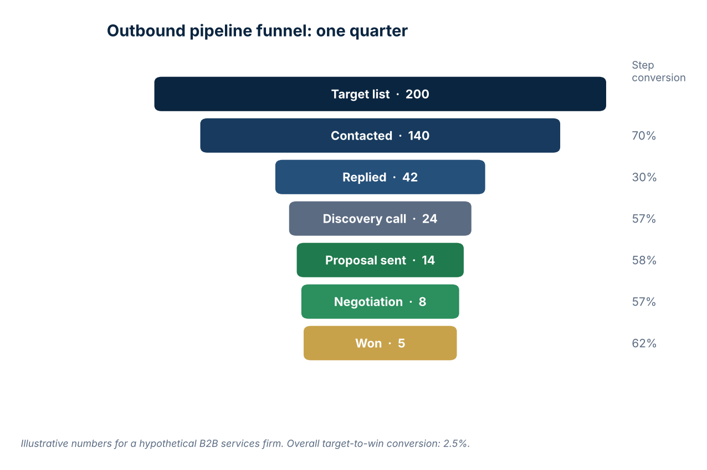
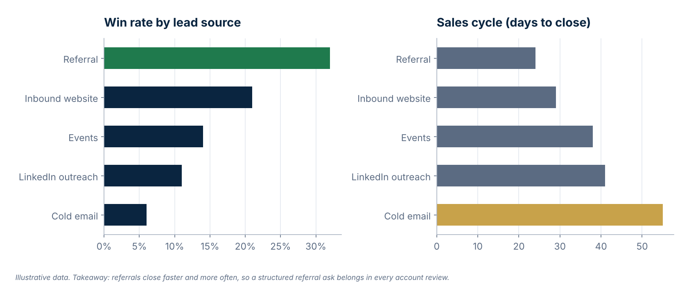
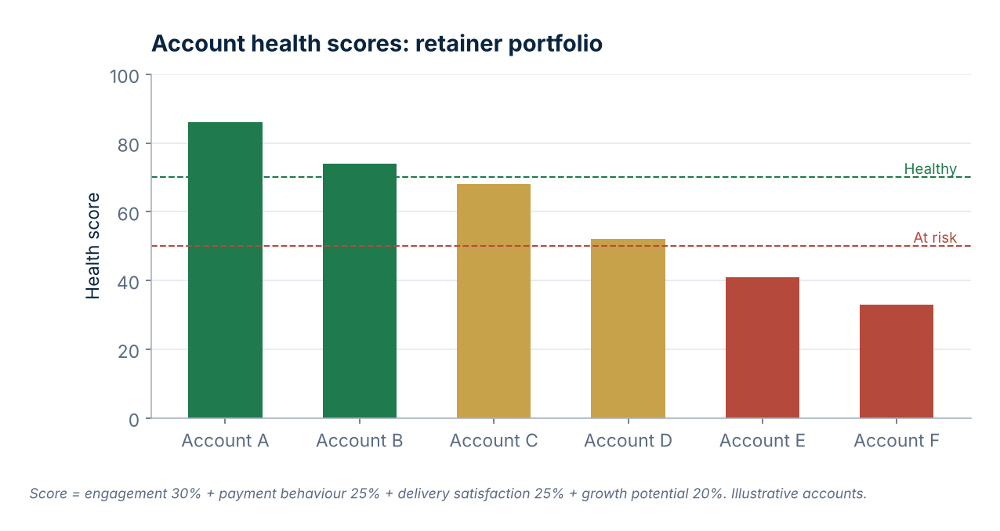

# B2B Sales Pipeline Playbook

**A repeatable system for winning and keeping B2B retainer clients**, from deciding who to target through to account reviews that produce renewals and referrals.

It turns the way I build pipelines in practice into a documented process with a working tracker. Win rates and other figures are **illustrative sample data for a fictional services firm**. No real client names or results are included.

---

## 1. The business problem

Many small agencies and B2B service firms run sales on memory and goodwill: leads sit in inboxes, follow-ups slip, and nobody can say what the pipeline is really worth. Revenue becomes lumpy, and existing clients churn quietly because nobody is watching account health.

## 2. Objectives

- Define **who** to target and **when** a deal is genuinely progressing.
- Make the pipeline **measurable**: weighted value, conversion, cycle time, stale deals.
- Give account managers a simple **retention and growth** routine.

## 3. The system at a glance

```
Ideal client profile → Target list → Personalised first contact → Discovery → Proposal → Negotiation → Won
                                                                                               ↓
                                         Referral ask  ←  Quarterly account review  ←  Onboarding
```

### 3.1 Ideal client profile (ICP)

| Dimension | Good fit | Poor fit |
|---|---|---|
| Size & stage | Established or fast-growing, with a budget line for the service | Pre-revenue, no budget owner |
| Buying behaviour | Values quality and process; makes decisions in weeks | Shops on price alone; long procurement for small work |
| Decision-maker | Reachable founder, MD or functional head | Only gatekeepers reachable |
| Strategic value | Referenceable brand; potential for multi-service work | One-off, low-visibility jobs |

### 3.2 Stage definitions and exit criteria

A deal moves stage only when the exit criterion is met. This keeps forecasts honest.

| Stage | Win probability | Exit criterion |
|---|:-:|---|
| Contacted | 5% | Decision-maker identified; first personalised message sent |
| Replied | 10% | Prospect responds with interest |
| Discovery call | 25% | Pain, budget range, timeline and decision process understood |
| Proposal sent | 45% | Scoped, priced proposal with the economic buyer |
| Negotiation | 70% | Terms under discussion; no blocking objections |
| Won | 100% | Signed agreement or PO |

### 3.3 Outreach principles

- **One relevant first message per person**, specific to their business, not a generic sequence.
- Lead with a business observation (a gap, a launch, a competitor move), not a service list.
- Every interaction ends with a clear next step and a date.
- Log every touch the same day; a deal with no touch for 14 days is flagged.

## 4. Measuring the pipeline





**Reading the sample data:** referrals convert at roughly 3× the rate of LinkedIn outreach and close about 40% faster. **Action:** build a structured referral ask into every quarterly account review, and reserve outbound effort for high-fit ICP accounts.

## 5. Keeping and growing accounts



Each retained client gets a **health score** (engagement 30%, payment behaviour 25%, delivery satisfaction 25%, growth potential 20%) and a one-page **account plan**:

- Economic buyer, day-to-day contact and other stakeholders
- The client's business goals this year and how our work supports them
- Risks to retention and the mitigation
- Upsell / cross-sell opportunities and the referral ask
- Actions for the next 30 days

Accounts below 50 trigger a recovery plan within a week. Overdue payments are part of the score because late payment is often the first sign of a relationship at risk.

## 6. Deliverables

| File | Contents |
|---|---|
| [`templates/sales-pipeline-tracker.xlsx`](templates/sales-pipeline-tracker.xlsx) | **Summary** (live weighted pipeline, win rate, stale-deal count, chart) · **Pipeline** (20 sample deals, drop-down stages, weighted value, stale flags) · **Stages** (editable probabilities and exit criteria) · **Account plan** template · **Account health** scoring |

## 7. How to use

1. Clear the sample rows on **Pipeline** and add your deals. Choose the stage from the drop-down.
2. Adjust probabilities on **Stages** once you have three months of your own conversion data.
3. Review **Summary** weekly. Anything highlighted red on "Days since touch" gets a next action today.
4. Complete an **Account plan** and **Account health** score for every retained client each quarter.

---

<sub>Prepared by <a href="https://github.com/sohaibshabbir9-del">Sohaib Shabbir</a> · Business development & account management · Sample data is fictional.</sub>
